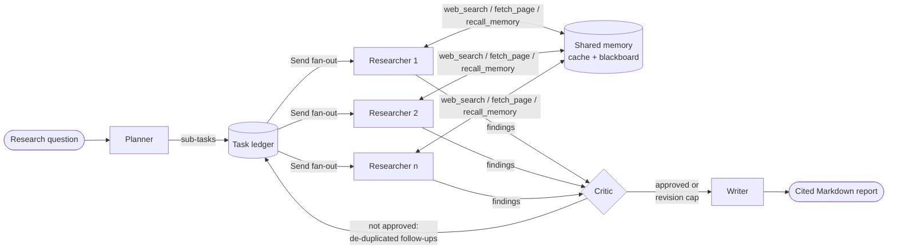

# Multi-Agent Research Assistant

**Planner, researcher and critic agents that collaborate autonomously to research a question
on the web and write a cited report.** It is built on **LangGraph** (primary orchestrator),
**Microsoft AutoGen** (alternative backend) and the **Anthropic API** (Claude).

An illustrative session (abridged):

```text
$ research-assistant run "How have the levelized costs of solar and wind changed since 2010, and why?"

     planner plan          Planned 4 sub-tasks
                           1. How has utility-scale solar PV LCOE changed 2010-2024?
                           2. How has onshore and offshore wind LCOE changed 2010-2024?
                           3. What technical and market factors drove the declines?
                           4. How do current renewable costs compare with fossil generation?
  researcher task_started  How has utility-scale solar PV LCOE changed 2010-2024?
  researcher tool_call     web_search(query='IRENA solar PV LCOE 2010 2023 global weighted average')
  researcher tool_call     fetch_page(url='https://www.irena.org/...', focus='LCOE 2010 vs 2023')
  summarizer summarize     Condensing https://www.irena.org/...
  researcher finding       How has utility-scale solar PV LCOE ... -> confidence 0.86, 3 sources
         ...
      critic critique      score 0.68 - 2 follow-ups
      critic revision      Round 2: 1 new sub-task(s), 1 duplicate(s) skipped
         ...
      critic critique      score 0.87 - approved
      writer report        Report drafted: The Collapse in Solar and Wind Costs, 2010-2024
```

---

## Highlights

| Capability | How it is implemented |
|---|---|
| **Autonomous multi-agent collaboration** | A LangGraph `StateGraph` routes work Planner → Researchers → Critic → Writer. The planner's sub-tasks fan out to **parallel researcher branches** with the `Send` API, and an additive reducer merges their findings back into state. |
| **Tool calling** | Researchers run an agentic loop over Claude tool use with **strict JSON-schema tools**: `web_search`, `fetch_page` (HTML and PDF), `recall_memory` and a `submit_findings` *finish tool* that returns schema-validated output. Parallel tool calls run concurrently, and each sub-task has a tool-call budget. |
| **Summarization** | Pages over a size threshold are condensed by a summarizer agent, keyed to the researcher's stated `focus`. Summaries are cached per (URL, focus). |
| **Self-correction loops** | (1) The **critic** scores coverage, evidence and consistency, and adds follow-up sub-tasks that trigger another research round. (2) **Hallucinated citations** (URLs no tool ever returned) are stripped and confidence is lowered. (3) A researcher that stops without submitting is nudged; if that fails, its findings are extracted from the transcript. (4) Tool errors go back to the model as `is_error` results, so it can recover. |
| **Shared memory / state** | `SharedMemory` holds a thread-safe **task ledger** (status, attempts, origin, revision), a **knowledge cache** of searches and pages persisted across runs, and a **blackboard** of findings that other researchers can query. |
| **Less redundant iteration** | Follow-up tasks are **de-duplicated** against the ledger (token Jaccard + sequence similarity), so the critic can't send the team back to work it already did. Repeated searches and page reads are cache hits. Revision rounds are capped. |
| **Structured agent contracts** | Every agent output (`ResearchPlan`, `FindingDraft`, `Critique`, `ReportDraft`) is a Pydantic model, sent to Claude as a strict JSON schema through structured outputs and validated on return. |
| **Two orchestration backends** | `--backend langgraph` (default) or `--backend autogen`: an AutoGen `SelectorGroupChat` with a deterministic speaker selector, using the same tools, memory and writer. |
| **Production touches** | Typed settings (`RA_*` env vars), prompt caching, server-side refusal fallbacks, per-agent token accounting, a REST API with SSE event streaming, a Docker image, CI, and 40+ offline tests. |

---

## Architecture



| Agent | Responsibility | Output contract |
|---|---|---|
| **Planner** | Breaks the question into ≤ N non-overlapping, searchable sub-questions with queries and success criteria | `ResearchPlan` |
| **Researcher** (×N, parallel) | Tool-using loop: search → read → cross-check → submit | `FindingDraft` via `submit_findings` |
| **Summarizer** | Condenses long pages to the researcher's focus | text (cached) |
| **Critic** | Scores findings 0–1, flags issues, proposes follow-ups; the approval rule is enforced in code | `Critique` |
| **Writer** | Synthesizes findings into a report with numbered `[n]` citations | `ReportDraft` |

See [docs/architecture.md](docs/architecture.md) for the design rationale, state model and
failure handling, and [docs/TECH_STACK.md](docs/TECH_STACK.md) for a detailed guide to every
technology: what it is, where it is used, and why it was chosen.

---

## Quick start

```bash
git clone <this repo> && cd multi-agent-research-assistant
python -m venv .venv && source .venv/bin/activate     # Windows: .venv\Scripts\activate
pip install -e ".[dev,api,autogen]"
cp .env.example .env                                   # then add your ANTHROPIC_API_KEY
```

Run a research task:

```bash
research-assistant run "What are the main approaches to long-context handling in LLMs, and their trade-offs?"
```

Common options:

```bash
research-assistant run "..." --backend autogen          # AutoGen group chat instead of LangGraph
research-assistant run "..." -o report.md --json run.json
research-assistant run "..." --max-subtasks 4 --max-revisions 1 --sequential -v
research-assistant memory stats                          # inspect the persistent cache
research-assistant serve --port 8000                     # REST API
```

From Python:

```python
from research_assistant import run_research

report = run_research("How do solid-state batteries compare with lithium-ion today?")
print(report.to_markdown())
print(report.final_score, report.usage.input_tokens, report.memory_stats)
```

## REST API

```bash
research-assistant serve
curl -X POST localhost:8000/research -H "content-type: application/json" \
     -d '{"question": "What is retrieval-augmented generation and when does it fail?"}'
# -> {"run_id": "run_3f9c...", "status": "queued"}

curl -N localhost:8000/research/run_3f9c.../events      # live Server-Sent Events from every agent
curl localhost:8000/research/run_3f9c...                 # status + full report JSON
curl localhost:8000/research/run_3f9c.../report.md       # rendered Markdown
```

Interactive docs are at `http://localhost:8000/docs`. A Python client example is in
[examples/api_client.py](examples/api_client.py).

## Docker

```bash
docker build -t research-assistant .
docker run --rm -p 8000:8000 -e ANTHROPIC_API_KEY=$ANTHROPIC_API_KEY research-assistant
```

---

## Configuration

All settings can be set with environment variables or in `.env`. See [.env.example](.env.example).

| Variable | Default | Purpose |
|---|---|---|
| `ANTHROPIC_API_KEY` | – | Claude API key (or use an `ant auth login` profile) |
| `RA_MODEL` | `claude-opus-5-5` | Planner / critic / writer model |
| `RA_WORKER_MODEL` | `claude-opus-5-5` | Researcher / summarizer model (e.g. set `claude-sonnet-5-5` to cut cost) |
| `RA_PLANNER_EFFORT` … `RA_SUMMARIZER_EFFORT` | `high` / `medium` / `low` | Per-agent reasoning effort |
| `RA_MAX_SUBTASKS` | `6` | Planner fan-out cap |
| `RA_MAX_REVISIONS` | `2` | Critic-driven self-correction rounds |
| `RA_MAX_TOOL_CALLS_PER_TASK` | `8` | Researcher tool budget per sub-task |
| `RA_APPROVAL_THRESHOLD` | `0.75` | Critic score needed to approve |
| `RA_PARALLEL_RESEARCH` | `true` | Fan out researchers concurrently |
| `RA_SEARCH_PROVIDER` | `duckduckgo` | `duckduckgo` (no key) or `tavily` (`TAVILY_API_KEY`) |
| `RA_SUMMARIZE_THRESHOLD_CHARS` | `6000` | Pages longer than this are summarized |
| `RA_DUPLICATE_SIMILARITY` | `0.82` | Similarity at which a sub-task counts as a duplicate |
| `RA_MEMORY_DIR` | `.research_memory` | Persistent cache and per-run ledgers |
| `RA_ENABLE_FALLBACKS` | `true` | Server-side refusal fallbacks (`fallbacks="default"`) |

---

## Project layout

```text
src/research_assistant/
├── agents/            planner, researcher, critic, writer, summarizer
├── tools/             search providers, HTML/PDF fetcher, memory-aware toolbox
├── graph.py           LangGraph state graph + ResearchOrchestrator
├── autogen_backend.py AutoGen SelectorGroupChat backend + Claude request adapter
├── llm.py             LLMClient interface, ClaudeLLM (structured output, tool loop, usage)
├── memory.py          SharedMemory: task ledger, knowledge cache, blackboard
├── models.py          Pydantic contracts between agents
├── schema.py          Pydantic -> strict JSON Schema conversion
├── prompts.py         static, cache-friendly system prompts
├── api.py             FastAPI app (jobs, polling, SSE)
├── cli.py             Typer CLI
└── config.py          pydantic-settings configuration
tests/                 offline test suite (scripted LLM, fake SDK clients)
examples/              quickstart and API client scripts
docs/architecture.md   design notes
```

## Testing

```bash
pytest            # 40+ tests, fully offline: no API key or network needed
ruff check src tests
```

The suite drives **both orchestration backends end to end** with scripted LLMs. It covers the
parallel fan-out, the critic's revision loop and its bounds, duplicate follow-up suppression,
cache hits, hallucinated-source removal and transcript recovery. It also exercises the real
`ClaudeLLM` request construction (strict schemas, effort, fallbacks, prompt caching, the
parallel tool-result format and tool budgets) against a fake Anthropic client. The AutoGen
adapter has its own check: sampling params must be stripped and thinking blocks restored on
every request.

## Design notes

- **Why a manual tool loop instead of the SDK tool runner?** The researcher needs controls the
  runner doesn't expose: a hard per-task tool budget, a finish tool that ends the loop with
  validated structured output, and a one-time nudge when the model stops early.
- **Why enforce the critic's approval rule in code?** It makes the loop's stopping condition
  deterministic: approve iff score ≥ threshold and no critical issue, and stop when there is
  nothing new to research. That holds even if the model's `approved` flag disagrees with its
  own score.
- **Why de-duplicate at the ledger rather than in the prompt?** The prompt asks the critic not to
  repeat itself, but the ledger guarantees it. Each revision round can only add genuinely new work.
- **Prompt caching.** System prompts are static and marked `cache_control`, so repeated calls
  from the same agent (parallel researchers especially) reuse the cached prefix.

## License

MIT. See [LICENSE](LICENSE).
