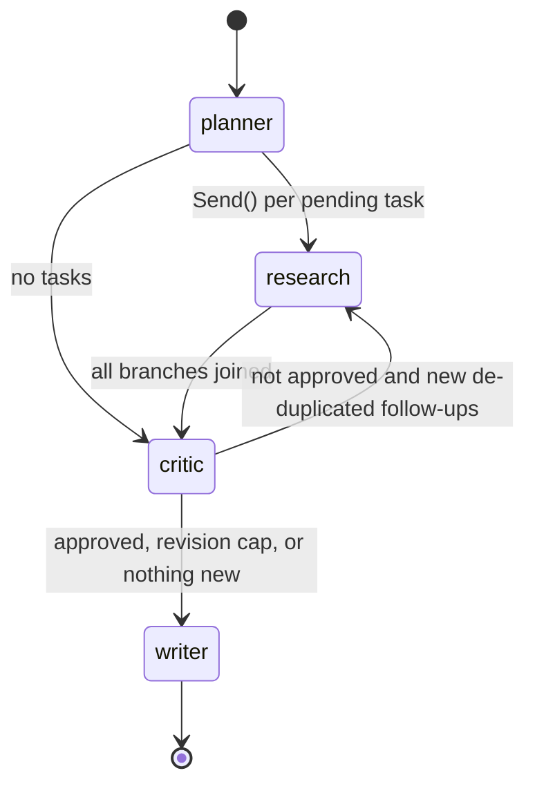

# Architecture

This document explains how the agents coordinate, what state they share, and how the system
recovers from errors.

## 1. Control flow (LangGraph backend)



`ResearchState` (a `TypedDict`) is the graph state:

| Key | Reducer | Written by |
|---|---|---|
| `question` | overwrite | input |
| `plan` | overwrite | planner |
| `findings` | `operator.add` (append) | each parallel researcher branch |
| `critiques` | `operator.add` | critic |
| `revision` | overwrite | planner (0), critic (+1) |
| `draft`, `sources` | overwrite | writer |

The routing function `dispatch` is shared by the planner and critic edges. It reads the
**task ledger** in shared memory and returns either a list of `Send("research", {...})` objects
(one per pending task) or the name of the next node. LangGraph runs the `Send` branches
concurrently (bounded by `max_concurrency`) and joins them before the critic runs, so the critic
always sees the complete set of findings for a round.

## 2. Shared memory

`SharedMemory` is the single source of truth that every agent reads and writes. It is
thread-safe (an `RLock` around all mutations) because researchers run in parallel.

1. **Task ledger** – `SubTask` records with `status` (pending → in_progress → done/failed),
   `attempts`, `origin` (planner/critic) and `revision`. New tasks are compared with existing
   ones using `max(jaccard, 0.5·jaccard + 0.5·sequence_ratio)` over normalized, stop-word-filtered
   tokens; matches above `RA_DUPLICATE_SIMILARITY` are skipped and counted in
   `stats.duplicate_tasks_skipped`. Failed tasks never block a retry.
2. **Knowledge cache** – search results keyed by normalized query, pages keyed by normalized
   URL (scheme/host lower-cased, fragment and trailing slash removed), and per-focus page
   summaries. It is saved atomically to `RA_MEMORY_DIR/cache.json` and reloaded on the next
   run.
3. **Blackboard** – published `Finding`s. The researcher's `recall_memory` tool searches it so
   one researcher can build on another's work instead of searching again.

At the end of every run the ledger and findings are written to
`RA_MEMORY_DIR/runs/<run_id>.json` for auditing.

## 3. Agent communication contracts

Agents never parse each other's prose. Every hand-off is a Pydantic model:

```
Planner  --ResearchPlan-->  ledger  --SubTask-->  Researcher  --Finding-->  blackboard
Critic   <--[Finding]--  ;  Critic --Critique(follow_up_tasks)-->  ledger
Writer   <--[Finding] + Critique.issues  -->  ReportDraft  -->  ResearchReport
```

`schema.strict_json_schema` converts each model into a schema that Claude's strict structured
outputs accept: `$ref`s are inlined, every object gets `additionalProperties: false` with all
properties required, and keywords strict mode does not enforce (numeric bounds, formats,
defaults) are dropped. Pydantic validators re-apply those bounds after parsing, for example by
clamping scores to [0, 1].

## 4. The researcher's tool loop

```
user: sub-question + suggested queries + budget
loop (≤ budget + 4 model turns):
    assistant: [thinking] [tool_use…]          ← full content appended (history is append-only)
    if tool_use == submit_findings → return its validated input
    if no tool_use → nudge once ("call submit_findings now"), then give up
    run all tool_use blocks concurrently       ← one user message with every tool_result
    over budget → is_error "budget exhausted, submit now"
```

Afterwards, `_verify_sources` keeps only cited URLs that some tool actually returned. It
records the removal under `gaps` and lowers confidence. If the loop never submitted,
findings are extracted from the transcript with a structured-output call.

## 5. Critic policy and the self-correction loop

The model proposes `score`, `approved`, `issues` and `follow_up_tasks`.
`apply_review_policy` then enforces these rules:

- approve **iff** `score ≥ RA_APPROVAL_THRESHOLD` and no `critical` issue;
- keep at most 3 follow-ups, and only when the critique is not approved and another round is
  allowed;
- a rejection with nothing actionable left counts as approval;
- in the final round (`revision == RA_MAX_REVISIONS`) the critic is told no more research will
  run and any follow-ups are discarded.

The loop is therefore guaranteed to terminate after at most `RA_MAX_REVISIONS + 1` reviews. It
also ends early as soon as follow-ups stop adding new ledger entries.

## 6. AutoGen backend

`AutoGenOrchestrator` builds three `AssistantAgent`s in a `SelectorGroupChat`. A
deterministic `selector_func` replaces LLM-based speaker selection:

```
user → planner → researcher (repeats while ledger has pending tasks) → critic
critic → researcher if follow-ups were queued, otherwise ExternalTermination fires
```

The agents share state through tools over the same `SharedMemory` (`register_plan`,
`get_pending_tasks`, `submit_finding`, `get_findings`, `submit_review`, plus the research tools).
The backend-agnostic `WriterAgent` then writes the report, so both backends return identical
`ResearchReport` objects.

`autogen-ext`'s Anthropic client predates current Claude models, so `_ClientAdapter` wraps
its `AsyncAnthropic` and makes three changes to every request:

1. it removes `temperature`/`top_p`/`top_k` (current models reject sampling parameters) and sets
   `output_config.effort`;
2. it restores each assistant turn's **original content blocks**, thinking blocks included,
   keyed by tool_use ids or text. AutoGen rebuilds assistant turns from its own types, which
   drops thinking blocks and inserts empty text blocks; restoring them keeps the history
   append-only;
3. it records token usage per agent and raises refusals as typed errors.

## 7. Failure handling

| Failure | Behaviour |
|---|---|
| Search/fetch error, HTTP 4xx/5xx, unsupported content | returned to the model as an `is_error` tool result; the model adapts |
| Exception inside a tool | caught, reported as `is_error`, logged |
| Tool budget exceeded | `is_error` result telling the model to submit |
| Model stops without submitting | one nudge, then structured extraction from transcript |
| LLM error for one sub-task | that task is marked `failed`, a zero-confidence finding records the gap, and the run continues |
| Refusal | server-side fallback (`fallbacks="default"`); if the whole chain refuses, `LLMRefusalError` |
| Rate limit / 5xx | SDK retries with backoff; persistent failures raise `LLMError` with a clear message |
| Disk errors persisting memory | logged as warnings; the report is still returned |
